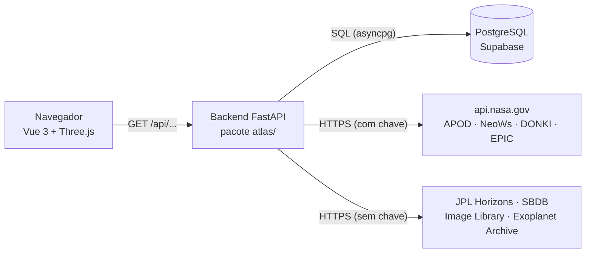
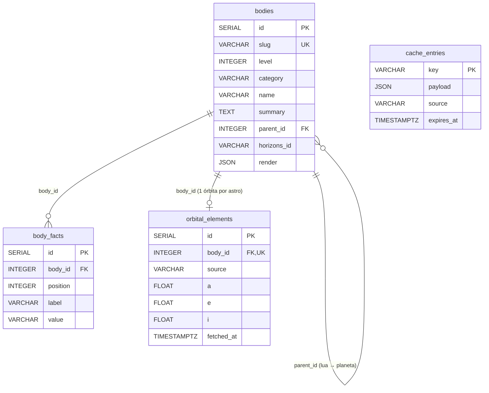

# Atlas do Cosmos 2.0 — Documentação do projeto

## Sumário

1. [O que é](#1-o-que-é)
2. [O que ele faz](#2-o-que-ele-faz)
3. [Stacks utilizadas](#3-stacks-utilizadas)
4. [Arquitetura](#4-arquitetura)
5. [Estrutura de pastas](#5-estrutura-de-pastas)
6. [Banco de dados](#6-banco-de-dados)
7. [Integração com a NASA](#7-integração-com-a-nasa)
8. [API REST](#8-api-rest)
9. [Como executar](#9-como-executar)
10. [Testes e qualidade](#10-testes-e-qualidade)
11. [Decisões e limitações](#11-decisões-e-limitações)
12. [Documentos relacionados](#12-documentos-relacionados)

---

## 1. O que é

O **Atlas do Cosmos** é uma simulação didática em 3D, feita para o navegador, que leva o
usuário do **Sistema Solar** até a **Via Láctea** e ao **Universo observável**. É voltado
para crianças e adultos: cada astro tem um card em português com resumo, tabela de dados e
curiosidade.

O projeto usa **dados reais da NASA**: as órbitas vêm do JPL, os asteroides da semana vêm
do NeoWs, há a foto astronômica do dia, as erupções solares recentes, as fotos da Terra
inteira e as estrelas com exoplanetas conhecidos.

A organização segue a das apostilas da disciplina (Unidades 1 a 6): *Application Factory*,
extensões com `init_app`, um pacote por domínio, `pyproject.toml`, Invoke e PyTest. A
diferença é que o framework usado é o **FastAPI** em vez do Flask.

## 2. O que ele faz

### Três níveis de escala

| Nível | O que mostra | Escala | Astros no catálogo |
|---|---|---|---|
| 1. Sistema Solar | Sol, 8 planetas, luas, planetas anões, cometa Halley, sondas Voyager 1 e 2 e New Horizons, cinturões de asteroides e de Kuiper, asteroides que passam perto da Terra na semana | Unidades astronômicas (UA) | 28 |
| 2. Via Láctea | ~95 mil partículas formando a galáxia, braços espirais, estrelas famosas, nebulosas, aglomerados, o buraco negro central e milhares de estrelas com exoplanetas | Milhares de anos-luz | 24 |
| 3. Universo | Grupo Local, galáxias famosas e grandes estruturas do Universo | Milhões de anos-luz | 19 |

O catálogo tem **71 astros** no total. A passagem entre os níveis é contínua: afastar a
câmera além do limite de um nível leva ao próximo, e aproximar volta ao anterior.

### Funcionalidades

- **Movimento real dos astros:** planetas, luas, Ceres e o cometa Halley se movem pela
  equação de Kepler a partir dos elementos orbitais do JPL. O tempo pode andar de 1 hora a
  100 anos por segundo, para frente ou para trás, e o botão "Hoje" volta à data atual.
- **Cards dos astros:** ao clicar num astro aparecem o resumo, a tabela de dados, a
  curiosidade, as fotos da NASA e os painéis ao vivo de cada caso: erupções solares no Sol,
  foto da Terra inteira na Terra, asteroides da semana e exoplanetas.
- **Foto astronômica do dia (APOD).**
- **Painel "Dados da NASA":** mostra de onde veio cada informação (ao vivo, cache,
  aproximação ou erro) e avisa se a chave da NASA não está configurada.
- **Controles de visualização:** tamanho dos astros (de ×60 até o tamanho real) e camadas
  liga/desliga (órbitas, asteroides, exoplanetas e nomes).
- **Funciona mesmo com a NASA fora do ar:** usa a última resposta guardada ou a tabela
  aproximada oficial do JPL.

## 3. Stacks utilizadas

### Backend

| Tecnologia | Versão testada | Para que serve |
|---|---|---|
| **Python** | 3.11+ (testado no 3.14) | Linguagem do backend |
| **FastAPI** | 0.162 | Framework web assíncrono (ASGI): rotas, validação e documentação automática |
| **Uvicorn** | 0.54 | Servidor ASGI que executa a aplicação |
| **Pydantic** / **pydantic-settings** | 2.14 / 2.16 | Esquemas das respostas JSON e leitura da configuração do `.env` |
| **SQLAlchemy** (assíncrono) | 2.1 | ORM: os modelos Python viram tabelas |
| **asyncpg** | 0.32 | Driver do PostgreSQL (Supabase) |
| **aiosqlite** | 0.22 | Driver do SQLite (desenvolvimento local e testes) |
| **httpx** | 0.28 | Cliente HTTP assíncrono para as APIs da NASA |
| **Typer** | 0.27 | Comandos de terminal (`atlas ...`) |

### Frontend

| Tecnologia | Versão | Para que serve |
|---|---|---|
| **Vue 3** | 3.5.13 | Interface reativa: barra superior, lista, cards, controles e janelas |
| **Three.js** | r170 | Renderização 3D (WebGL) dos três níveis |
| HTML, CSS e JavaScript (módulos ES) | — | Sem etapa de build: os arquivos são servidos como estão |

O Vue e o Three.js ficam em `frontend/vendor/`, então o site não depende de CDN.

### Banco de dados e infraestrutura

| Tecnologia | Uso |
|---|---|
| **PostgreSQL no Supabase** | Banco de produção (pooler na porta 6543, com SSL) |
| **SQLite** | Banco padrão em desenvolvimento (`instance/atlas.db`) e nos testes |

### Ferramentas de desenvolvimento

| Tecnologia | Uso |
|---|---|
| **PyTest** + **pytest-cov** | Testes automatizados e cobertura |
| **Ruff** | Lint e formatação |
| **Invoke** | Automação de tarefas (`invoke run`, `invoke test`...) |
| **setuptools** / `pyproject.toml` | Empacotamento e dependências |

## 4. Arquitetura

O projeto tem duas partes. O **frontend** conversa só com o **backend**, e só o backend
conversa com a NASA e com o banco.



Passar tudo pelo backend traz quatro vantagens:

1. **Segurança:** a chave da NASA e a senha do banco ficam só no servidor (`.env`) e nunca
   chegam ao navegador.
2. **Cache:** as respostas da NASA ficam guardadas no banco com validade. Muitos acessos ao
   site geram poucas consultas à NASA.
3. **Tratamento dos dados:** o backend converte formatos difíceis (o texto do Horizons, as
   coordenadas do Exoplanet Archive) em JSON simples.
4. **Resiliência:** se a NASA falhar, o backend devolve dados antigos ou aproximados.

### Padrões de projeto

- **Application Factory:** `create_app()` em `atlas/__init__.py` monta a aplicação. O
  `app.py` é o único ponto de entrada (`uvicorn app:app`).
- **Extensões com `init_app`:** cada parte de infraestrutura (configuração, banco, cache,
  clientes da NASA, camada web e CLI) fica em `atlas/ext/` e se liga à aplicação sem
  importá-la.
- **Um pacote por domínio**, sempre com os mesmos arquivos:

| Arquivo | Papel |
|---|---|
| `models.py` | Tabelas do banco (SQLAlchemy). Só existe quando o domínio tem tabela própria |
| `schemas.py` | Formato JSON das respostas (Pydantic), que aparece no `/api/docs` |
| `services.py` | Regras de negócio: consulta o banco, chama a NASA e monta o resultado |
| `routes.py` | Rotas HTTP finas, que apenas chamam o service |

- **Injeção de dependências do FastAPI:** cada requisição recebe uma sessão do banco, a
  configuração e o cliente da NASA.
- **Configuração 12-Factor:** tudo que muda entre ambientes vem de variáveis de ambiente ou
  do `.env`.

## 5. Estrutura de pastas

```
atlas-cosmos/
├── app.py                  # ponto de entrada: app = create_app()
├── pyproject.toml          # dependências, PyTest e Ruff
├── tasks.py                # tarefas do Invoke
├── .env.example            # modelo de configuração (copie para .env)
├── atlas/                  # backend (pacote Python)
│   ├── __init__.py         # create_app()
│   ├── ext/                # infraestrutura
│   │   ├── config/         # configuração (.env)
│   │   ├── db/             # conexão com o banco (SQLite ou Supabase)
│   │   ├── cache/          # cache das respostas da NASA
│   │   ├── nasa/           # um cliente por API da NASA
│   │   ├── web/            # CORS, GZip, erros, /api/health e arquivos do frontend
│   │   ├── cli/            # comandos `atlas ...`
│   │   └── lifecycle.py    # inicialização e encerramento
│   ├── catalog/            # astros e textos didáticos (+ data/catalog.json)
│   ├── orbits/             # órbitas (JPL) e sondas
│   ├── neo/                # asteroides próximos da Terra
│   ├── exoplanets/         # estrelas com exoplanetas
│   ├── media/              # foto do dia, foto da Terra e fotos dos astros
│   └── spaceweather/       # erupções solares
├── frontend/               # Vue 3 + Three.js
│   ├── index.html
│   ├── css/style.css
│   ├── js/components/      # componentes Vue
│   ├── js/engine/          # motor 3D
│   └── vendor/             # Vue e Three.js
├── tests/                  # PyTest + NASA simulada
└── docs/                   # documentação detalhada
```

## 6. Banco de dados

O banco de produção é um **PostgreSQL hospedado no Supabase**. Em desenvolvimento e nos
testes, o padrão é o SQLite. A troca é feita só pela variável `DATABASE_URL` do `.env`, e o
código não muda.

As tabelas são criadas pelo **SQLAlchemy** a partir dos modelos Python, com
`atlas init-db` ou ao subir o servidor. Não há arquivo SQL para executar à mão.

### Modelo de dados



O diagrama mostra só as colunas principais. A lista completa está em
[`docs/banco.md`](docs/banco.md).

| Tabela | O que guarda | De onde vêm os dados |
|---|---|---|
| `bodies` | Os 71 astros: nome, categoria, nível, textos didáticos, IDs nas APIs da NASA e parâmetros do 3D | `atlas/catalog/data/catalog.json` |
| `body_facts` | As linhas da tabela de dados de cada card (ex.: "Diâmetro: 6.779 km") | `catalog.json` |
| `orbital_elements` | Os elementos orbitais de cada astro (a, e, i, Ω, ω, M, n e a época) | JPL Horizons e SBDB |
| `cache_entries` | As respostas da NASA já processadas, com data de validade | Todas as APIs da NASA |

### Decisões do modelo

- **Autorrelacionamento em `bodies`:** uma lua aponta para o seu planeta (`parent_id`). Se o
  planeta for apagado, a lua fica sem "pai" (`ON DELETE SET NULL`).
- **1:N entre `bodies` e `body_facts`:** cada card tem várias linhas, em ordem fixa (a
  combinação `body_id` + `position` é única). Elas são apagadas junto com o astro
  (`ON DELETE CASCADE`).
- **1:1 entre `bodies` e `orbital_elements`:** `body_id` é único, então há no máximo uma
  órbita por astro.
- **Colunas JSON** (`render`, `action`, `live` e `payload`): cada tipo de astro precisa de
  parâmetros diferentes (um planeta tem raio e textura; uma galáxia tem coordenadas e
  distância), e as respostas da NASA mudam de formato de uma API para outra.
- **Cache com validade:** o sistema consulta a NASA de novo só quando `expires_at` passa.
  Se a NASA falhar, devolve a resposta vencida marcada como "antiga".
- **Nada a migrar:** todo o conteúdo do banco pode ser recriado, porque o catálogo vem do
  JSON e o resto vem da NASA. Por isso o projeto usa `create_all()` em vez de migrações.

### Segurança no Supabase

- A conexão usa **SSL** e o **pooler na porta 6543**. Nessa porta, o cache de *prepared
  statements* do asyncpg é desligado, porque o pooler não o suporta.
- As quatro tabelas têm **RLS (Row Level Security) ligado e sem policies**. Assim, a API
  REST pública do Supabase não lê nem altera nada. O backend conecta como dono das tabelas
  e não é afetado.
- A senha do banco fica só no `.env`, que não vai para o Git. A CLI mostra a URL com a senha
  escondida (`***`).

## 7. Integração com a NASA

| Dado | API | Precisa de chave? | Validade do cache |
|---|---|---|---|
| Órbitas de planetas, luas e Plutão | JPL Horizons | não | 24 h |
| Órbitas de Ceres e do cometa Halley | JPL Small-Body Database | não | 24 h |
| Posição das Voyager 1 e 2 e da New Horizons | JPL Horizons | não | 24 h |
| Asteroides que passam perto da Terra | NeoWs | sim | 3 h |
| Foto astronômica do dia | APOD | sim | 6 h |
| Erupções solares dos últimos 30 dias | DONKI | sim | 1 h |
| Foto da Terra inteira | EPIC | sim | 3 h |
| Fotos de cada astro | NASA Image and Video Library | não | 7 dias |
| Estrelas com exoplanetas | NASA Exoplanet Archive | não | 7 dias |

Os textos didáticos em português não existem em nenhuma API da NASA. Eles ficam no
catálogo do projeto (`catalog.json`).

## 8. API REST

| Rota | O que devolve |
|---|---|
| `GET /api/health` | Estado da API e da chave da NASA |
| `GET /api/catalog/levels` | Os três níveis de escala |
| `GET /api/catalog/bodies` | A lista de astros |
| `GET /api/catalog/bodies/{slug}` | Os detalhes de um astro |
| `GET /api/orbits` | As órbitas de todos os astros e a posição das sondas |
| `GET /api/neo/week` | Os asteroides que passam perto da Terra na semana |
| `GET /api/exoplanets/hosts` | As estrelas com exoplanetas |
| `GET /api/media/apod` | A foto astronômica do dia |
| `GET /api/media/epic` | As últimas fotos da Terra inteira |
| `GET /api/media/images/{slug}` | As fotos da NASA de um astro |
| `GET /api/space-weather/flares` | As erupções solares recentes |

Com o servidor rodando, a documentação interativa fica em
`http://127.0.0.1:8000/api/docs`. Os detalhes de cada rota estão em
[`docs/API.md`](docs/API.md).

## 9. Como executar

Requisitos: Python 3.11 ou mais novo e um navegador atual.

```powershell
python -m venv .venv
.\.venv\Scripts\Activate.ps1        # Linux/macOS: source .venv/bin/activate
pip install -e ".[dev,test]"
Copy-Item .env.example .env         # depois preencha NASA_API_KEY e DATABASE_URL
atlas init-db                       # cria as tabelas e carrega o catálogo
invoke run                          # ou: uvicorn app:app --reload
```

Depois, abra `http://127.0.0.1:8000`.

### Configuração (`.env`)

| Variável | O que define |
|---|---|
| `NASA_API_KEY` | Chave pessoal de https://api.nasa.gov. Sem ela, o projeto usa a `DEMO_KEY`, que tem limite baixo |
| `DATABASE_URL` | Endereço do banco. Se a linha estiver comentada, usa o SQLite local; para o Supabase, use a URL do *Transaction pooler* |
| `ORBITS_TTL_HOURS`, `NEO_TTL_MINUTES`, `APOD_TTL_MINUTES` | Por quanto tempo reaproveitar os dados da NASA |
| `NEO_LIMIT` | Quantos asteroides próximos mostrar |
| `PREFETCH_ON_STARTUP` | Buscar as órbitas assim que o servidor sobe |
| `SERVE_FRONTEND`, `CORS_ORIGINS` | Servir o frontend pelo backend e quais origens liberar |

### Comandos

| Comando | O que faz |
|---|---|
| `invoke run` | Sobe o servidor de desenvolvimento |
| `invoke test` / `invoke cov` | Roda os testes / com cobertura |
| `invoke lint` / `invoke format` | Verifica / formata o código |
| `atlas init-db [--reset]` | Cria (ou recria) as tabelas e carrega o catálogo |
| `atlas seed --replace` | Recarrega o catálogo depois de editar o `catalog.json` |
| `atlas refresh` | Atualiza agora as órbitas a partir do JPL |
| `atlas check-nasa` | Testa a chave da NASA |
| `atlas shell` | Abre um console Python com a aplicação e o banco |

## 10. Testes e qualidade

- **41 testes** automatizados com PyTest e **91% de cobertura** do pacote `atlas`.
- Os testes **não acessam a internet**: `tests/nasa_mock.py` simula todas as APIs da NASA
  no formato das respostas reais, incluindo falhas e cache vencido.
- Cada teste recebe uma aplicação nova com um banco SQLite temporário.
- `tests/test_db.py` cobre a configuração do Supabase: driver, SSL, pooler e senha
  escondida.
- O código passa no **Ruff** (lint e formatação).

## 11. Decisões e limitações

- **Tamanhos ampliados:** os astros aparecem ×60 maiores para caberem na tela, mas as
  distâncias são reais. O controle "Tamanho dos astros" vai até o tamanho real.
- **Luas:** usam a órbita real do JPL, mas com a distância ampliada junto com o tamanho.
- **Representações:** os braços da Via Láctea, os cinturões de asteroides e de Kuiper e as
  galáxias de fundo do nível Universo são ilustrativos.
- **Dependência da NASA:** algumas APIs da NASA ficam fora do ar de vez em quando (o APOD,
  por exemplo). O site continua funcionando com os dados em cache ou aproximados, e o
  painel "Dados da NASA" avisa.
- **Evolução do banco:** `create_all()` só cria tabelas novas e não altera as existentes. Se
  o esquema passar a guardar dados que não podem ser perdidos, o próximo passo é usar o
  **Alembic** para migrações.

## 12. Documentos relacionados

| Documento | Conteúdo |
|---|---|
| [`README.md`](README.md) | Instalação rápida, chave da NASA e Supabase |
| [`docs/ARQUITETURA.md`](docs/ARQUITETURA.md) | Funcionamento interno detalhado: ciclo de vida, cache, motor 3D, mecânica orbital |
| [`docs/API.md`](docs/API.md) | Todas as rotas da API, com parâmetros e exemplos |
| [`docs/banco.md`](docs/banco.md) | Script SQL completo do banco físico e consultas úteis |
