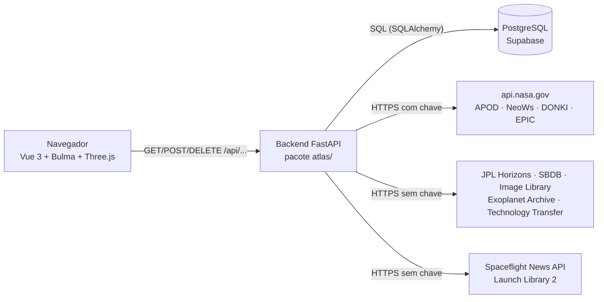
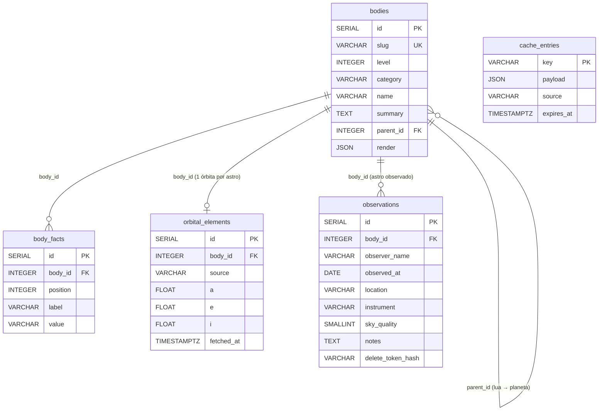

# Atlas do Cosmos — Documentação do projeto

| | |
|---|---|
| **Projeto** | Atlas do Cosmos — blog de notícias do espaço + simulador 3D com dados reais da NASA |
| **Integrantes** | Ana Carla Del Puppo da Silva Velten · Lara Miranda Fernandes
| **Disciplina** | Desenvolvimento de Sistemas Para WEB
| **Stack** | FastAPI · SQLAlchemy · PostgreSQL (Supabase) · Vue 3 · Bulma · Three.js |

## Sumário

1. [Descrição geral e funcionalidades](#1-descrição-geral-e-funcionalidades)
2. [Como o projeto atende aos critérios](#2-como-o-projeto-atende-aos-critérios)
3. [Tecnologias utilizadas e justificativa](#3-tecnologias-utilizadas-e-justificativa)
4. [Arquitetura adotada](#4-arquitetura-adotada)
5. [Banco de dados](#5-banco-de-dados)
6. [Detalhamento técnico do código](#6-detalhamento-técnico-do-código)
7. [Testes automatizados](#7-testes-automatizados)
8. [Como rodar o projeto](#8-como-rodar-o-projeto)
9. [Principais desafios e soluções](#9-principais-desafios-e-soluções)
10. [Limitações conhecidas](#10-limitações-conhecidas)
11. [Documentos relacionados](#11-documentos-relacionados)

---

## 1. Descrição geral e funcionalidades

O **Atlas do Cosmos** é um site sobre o espaço, feito para crianças e adultos. Ele tem
duas abas:

- **Blog** (página inicial): um portal de notícias sobre o espaço e a tecnologia espacial,
  com conteúdo vindo de APIs abertas, sem nenhum texto fixo no código.
- **Simulador**: uma viagem em 3D do Sistema Solar até a Via Láctea e o Universo
  observável, com as órbitas reais calculadas pelo JPL (NASA).

Toda informação que muda com o tempo vem de APIs reais. O navegador conversa só com o
backend do Atlas, que consulta as APIs, guarda as respostas em cache no banco e entrega JSON
pronto para a interface.

### Blog

| Funcionalidade | De onde vêm os dados |
|---|---|
| Imagem astronômica do dia em destaque | NASA APOD (com dois planos B, ver seção 9) |
| Linha do tempo de notícias, blogs e relatórios, agrupada por dia | Spaceflight News API (agências e veículos especializados) |
| Filtros por tópico (Tecnologia, Lançamentos, Lua e Marte...), por tipo e busca livre | Spaceflight News API |
| Agenda de voos (lançamentos e pousos) em página própria | Launch Library 2 (The Space Devs) |
| Asteroides que passam perto da Terra nesta semana | NASA NeoWs |
| Tecnologias da NASA disponíveis para a sociedade, por área | NASA Technology Transfer |
| "Céu do seu nascimento": a APOD da data escolhida (ou imagens da NASA do ano) | NASA APOD e NASA Image Library |
| **Diário de observação**: formulário em que o visitante registra o que viu no céu | Banco de dados do Atlas |
| **Login, cadastro e "Meu perfil"** (bio, local e relatos de observação) | Navegador do visitante |

### Simulador

- **Três níveis de escala com transição contínua:** Sistema Solar (UA), Via Láctea (milhares
  de anos-luz) e Universo (milhões de anos-luz). Afastar a câmera leva ao próximo nível.
- **71 astros no catálogo**, cada um com card em português (resumo, tabela de dados,
  curiosidade, fotos da NASA e painéis ao vivo).
- **Órbitas reais:** planetas, luas, Ceres e o cometa Halley se movem pela equação de Kepler
  a partir dos elementos orbitais do JPL; o tempo anda de 1 hora a 100 anos por segundo.
- **Sondas reais:** posição das Voyager 1 e 2 e da New Horizons (JPL Horizons).
- **Transparência:** o painel "Dados da NASA" mostra se cada dado veio ao vivo, do cache ou
  de uma aproximação.

### Diário de observação (formulário)

O visitante escolhe o astro (lista do catálogo), a data, o instrumento, a qualidade do céu,
o nome, o local e anotações. O formulário envia os dados ao servidor, que **valida tudo**
(Pydantic) e grava no banco (SQLAlchemy). Se algo estiver errado, cada campo mostra a
mensagem do servidor, em português. Quem registrou uma observação pode apagá-la depois (o
navegador guarda um código secreto; o banco guarda só o hash dele).

### Login e "Meu perfil"

O **Simulador** e a página **Meu perfil** (`#/perfil`) só abrem depois do login ou do
cadastro, feitos numa janela modal (`LoginModal.js`). O formulário confere nome (mínimo de 2
letras), formato do e-mail, senha com pelo menos 6 caracteres e confirmação da senha
(`frontend/js/auth.js`). A sessão dura enquanto a aba estiver aberta (`sessionStorage`).

No perfil, o visitante edita nome, bio e local e publica relatos de observação, que podem ser
filtrados por astro e editados depois. Esses dados ficam no próprio navegador
(`localStorage`), separados por e-mail (`frontend/js/profile.js`).

## 2. Como o projeto atende aos critérios

| # | Critério | Onde está no projeto |
|---|---|---|
| 1 | Arquitetura modular e fábrica de aplicação | `create_app()` em `atlas/__init__.py`; extensões em `atlas/ext/` ligadas por `init_app(app)`; injeção de dependências do FastAPI (`SessionDep`, `NasaDep`, `settings_from`) |
| 2 | Organização em módulos / rotas | Um pacote por domínio (`catalog`, `orbits`, `neo`, `exoplanets`, `media`, `spaceweather`, `blog`, `observations`), cada um com `models` / `schemas` / `services` / `routes` e seu próprio `APIRouter` (equivalente ao Blueprint) |
| 3 | Formulários e validação | Diário de observação: `ObservationIn` (Pydantic) valida tipo, tamanho, faixa, data no futuro e campos extras; o service valida o astro no banco (`FormError`); `ext/web` traduz os erros para português, campo a campo (HTTP 422); o formulário Vue mostra cada mensagem ao lado do campo |
| 4 | Interface e frontend | Vue 3 com componentes, **Bulma** como framework CSS (formulário, grade de colunas, avisos, tags e botões do Diário), layout responsivo testado em celular (390 px) e desktop |
| 5 | Testes automatizados | **91 testes** PyTest (rotas, validação, ORM, cache, falhas da NASA, logging) com **93% de cobertura** + **36 testes** do frontend com `node:test` |
| 6 | Persistência e ORM | SQLAlchemy 2 assíncrono; 5 entidades com chaves estrangeiras, 1:1, 1:N, autorrelacionamento e `CHECK`; PostgreSQL no Supabase e SQLite em desenvolvimento |
| 7 | Qualidade e boas práticas | `.env` (12-Factor), logging com nível configurável, tratamento de erros padronizado (422/404/403/429/503/500), Ruff (lint e formatação), Invoke, Git com branches e pull requests |

## 3. Tecnologias utilizadas e justificativa

### Por que FastAPI e não Flask

As apostilas usam Flask. O projeto segue **a mesma organização** (Application Factory,
extensões com `init_app`, um pacote por domínio, `pyproject.toml`, Invoke, PyTest), mas usa
o **FastAPI** por três motivos ligados ao produto:

1. **Muitas chamadas externas ao mesmo tempo.** Para montar a tela, o backend consulta até
   oito APIs diferentes. O FastAPI é assíncrono (ASGI): enquanto espera a NASA, o servidor
   atende outras requisições, sem precisar de threads extras.
2. **Validação e documentação automáticas.** Os esquemas Pydantic validam a entrada (o
   formulário do Diário) e a saída de todas as rotas, e geram a documentação interativa em
   `/api/docs` sem código adicional.
3. **Injeção de dependências.** A sessão do banco, a configuração e o cliente da NASA chegam
   como parâmetros das rotas. Isso faz o papel do `current_app` e do `g` do Flask e facilita
   os testes (cada teste injeta uma NASA simulada).

| Conceito das apostilas (Flask) | Equivalente no Atlas (FastAPI) |
|---|---|
| `create_app()` | `create_app()` em `atlas/__init__.py` |
| Extensões com `init_app` | `atlas/ext/*/__init__.py` com `init_app(app)` |
| Blueprint | `APIRouter` de cada domínio |
| Flask-WTF / WTForms | Pydantic (`ObservationIn`) + mensagens traduzidas em `ext/web` |
| Flask-SQLAlchemy | SQLAlchemy 2 assíncrono em `ext/db` |
| `current_app`, `g` | Dependências (`SessionDep`, `NasaDep`, `settings_from`) |
| `app.app_context()` | `app_context()` em `ext/lifecycle.py` (CLI, scripts, testes) |
| Templates Jinja2 | Frontend Vue 3 servido pelo próprio backend |

### Backend

| Tecnologia | Para que serve |
|---|---|
| **Python 3.11+** (testado no 3.14) | Linguagem do backend |
| **FastAPI** + **Uvicorn** | Framework web assíncrono e servidor ASGI |
| **Pydantic** / **pydantic-settings** | Validação de entrada e saída; leitura do `.env` |
| **SQLAlchemy 2** (assíncrono) | ORM: modelos Python viram tabelas |
| **asyncpg** / **aiosqlite** | Drivers do PostgreSQL (Supabase) e do SQLite |
| **httpx** | Cliente HTTP assíncrono para as APIs externas |
| **Typer** | Comandos de terminal (`atlas init-db`, `atlas refresh`...) |
| **logging** (biblioteca padrão) | Log de requisições, falhas externas e ações do Diário |

### Frontend

| Tecnologia | Para que serve |
|---|---|
| **Vue 3** | Componentes e estado reativo (blog, simulador, formulário) |
| **Bulma 1.0** | Framework CSS: campos, selects, textarea, mensagens de ajuda, grade de colunas, notificações, tags e botões |
| **Three.js** | Renderização 3D (WebGL) do simulador |
| Módulos ES, sem build | Os arquivos são servidos como estão; Vue, Three.js e Bulma ficam em `frontend/vendor/` (sem CDN) |

O Bulma é usado na versão com prefixo (`bulma-field`, `bulma-input`...) e carregado dentro de
uma **camada CSS** (`@layer`). Assim ele não altera o visual que já existia: o CSS próprio do
Atlas sempre tem prioridade (detalhes na seção 9).

### Banco de dados e ferramentas

| Tecnologia | Uso |
|---|---|
| **PostgreSQL no Supabase** | Banco de produção (pooler na porta 6543, SSL, RLS ligado) |
| **SQLite** | Banco padrão em desenvolvimento e nos testes |
| **PyTest** + **pytest-cov** | Testes e cobertura do backend |
| **node:test** | Testes do frontend (sem dependências) |
| **Ruff** | Lint e formatação |
| **Invoke** | Automação (`invoke run`, `invoke test`, `invoke package`...) |
| **Git / GitHub** | Versionamento com branches por funcionalidade e pull requests |

## 4. Arquitetura adotada



O navegador **só conversa com o backend**. Isso traz quatro vantagens:

1. **Segurança:** a chave da NASA e a senha do banco ficam só no servidor (`.env`).
2. **Cache:** as respostas externas ficam no banco com validade; muitos acessos geram poucas
   consultas às APIs (que têm cota).
3. **Tratamento dos dados:** formatos difíceis (texto do Horizons, linhas do Technology
   Transfer, HTML do APOD) viram JSON simples.
4. **Resiliência:** se uma API cair, o backend devolve a última cópia guardada ou um plano B.

### Camadas

```
app.py ──► create_app()                         (fábrica)
             ├── ext/ (infraestrutura)          config · log · db · cache · nasa · web · cli
             └── domínios                       catalog · orbits · neo · exoplanets
                                                media · spaceweather · blog · observations
                   cada domínio:
                     routes.py   ──► rotas finas (HTTP): recebem e devolvem esquemas
                     schemas.py  ──► Pydantic: formato e validação dos dados
                     services.py ──► regras de negócio: banco, APIs externas, cache
                     models.py   ──► tabelas (SQLAlchemy), quando o domínio tem tabela
```

### Estrutura de pastas

```
atlas-cosmos/
├── app.py                  # ponto de entrada: app = create_app()
├── pyproject.toml          # dependências, PyTest e Ruff
├── tasks.py                # tarefas do Invoke (run, test, lint, package...)
├── .env.example            # modelo de configuração (o .env real não vai para o Git)
├── atlas/                  # backend
│   ├── __init__.py         # create_app()
│   ├── ext/                # config, log, db, cache, nasa, web, cli, lifecycle
│   ├── catalog/            # astros e textos didáticos (+ data/catalog.json)
│   ├── orbits/             # órbitas (JPL) e sondas
│   ├── neo/                # asteroides próximos da Terra
│   ├── exoplanets/         # estrelas com exoplanetas
│   ├── media/              # APOD, EPIC, fotos dos astros, céu do nascimento
│   ├── spaceweather/       # erupções solares
│   ├── blog/               # notícias, lançamentos e tecnologias
│   └── observations/       # Diário de observação (formulário + banco)
├── frontend/
│   ├── index.html
│   ├── css/                # framework.css (Bulma), style.css, blog.css
│   ├── js/components/      # componentes Vue (blog/ e simulador)
│   ├── js/engine/          # motor 3D
│   ├── tests/              # testes do frontend (node:test)
│   └── vendor/             # Vue, Three.js e Bulma (com licenças)
├── tests/                  # PyTest + APIs externas simuladas
└── docs/                   # API.md, ARQUITETURA.md, banco.md
```

## 5. Banco de dados

Em produção o banco é um **PostgreSQL no Supabase**; em desenvolvimento e nos testes, o
**SQLite**. A troca é feita só pela variável `DATABASE_URL`, sem mudar o código. As tabelas
são criadas pelo SQLAlchemy a partir dos modelos (`atlas init-db` ou ao subir o servidor).

### Diagrama entidade-relacionamento



| Tabela | O que guarda | Origem dos dados |
|---|---|---|
| `bodies` | Os 71 astros: nome, categoria, nível, textos didáticos, IDs nas APIs e parâmetros do 3D | `catalog.json` |
| `body_facts` | As linhas da tabela de dados de cada card | `catalog.json` |
| `orbital_elements` | Os elementos orbitais de cada astro | JPL Horizons e SBDB |
| `observations` | O Diário de observação | Formulário do blog (visitantes) |
| `cache_entries` | As respostas das APIs externas já processadas, com validade | Todas as APIs |

### Decisões do modelo

- **Autorrelacionamento em `bodies`:** uma lua aponta para o seu planeta (`ON DELETE SET NULL`).
- **1:N** entre `bodies` e `body_facts` (ordem fixa, `UNIQUE(body_id, position)`) e entre
  `bodies` e `observations`; **1:1** entre `bodies` e `orbital_elements` (`body_id` único).
- **Integridade em duas camadas no Diário:** o Pydantic valida a entrada na API e o banco tem
  `CHECK (sky_quality BETWEEN 1 AND 5)` e `CHECK (instrument IN (...))`. Um teste grava direto
  pelo ORM, sem a API, e confirma que o banco recusa a nota 42.
- **Dados do usuário preservados:** `atlas seed --replace` recria o catálogo, o que apagaria
  as observações em cascata. O seed copia as observações antes e as religa aos astros novos
  pelo `slug`.
- **Segredos nunca em texto puro:** o código de exclusão de uma observação é guardado como
  hash SHA-256 e comparado com `hmac.compare_digest`.
- **Cache com validade:** a API externa só é consultada de novo quando `expires_at` passa; se
  ela falhar, a cópia vencida é usada e marcada como `stale`.
- **Supabase:** SSL, pooler na porta 6543 (sem cache de *prepared statements*) e **RLS
  ligado sem policies** em todas as tabelas, para a API REST pública do Supabase não ler nem
  alterar nada.

O script SQL completo (gerado dos modelos) está em [`docs/banco.md`](docs/banco.md).

## 6. Detalhamento técnico do código

### 6.1 Fábrica de aplicação (`atlas/__init__.py`)

Nenhum objeto `app` é criado na importação. A fábrica aplica a configuração, liga as
extensões e registra os domínios. Os testes criam uma aplicação nova por teste, com banco
temporário e uma NASA simulada (`nasa_transport`).

```python
DOMAINS = (catalog, orbits, neo, exoplanets, media, spaceweather, blog, observations)

def create_app(settings: Settings | None = None, *, nasa_transport=None) -> FastAPI:
    settings = settings or get_settings()
    app = FastAPI(title=settings.app_name, lifespan=lifespan, docs_url="/api/docs", ...)
    prepare_hooks(app)

    config.init_app(app, settings)   # extensões (infraestrutura)
    log.init_app(app)
    db.init_app(app)
    cache.init_app(app)
    nasa.init_app(app, transport=nasa_transport)
    web.init_app(app)

    for domain in DOMAINS:           # domínios (cada um registra seu APIRouter)
        domain.init_app(app)

    web.mount_frontend(app)          # por último, para não "engolir" as rotas /api
    return app
```

### 6.2 Um domínio: rotas finas, regras no service (`atlas/observations/routes.py`)

```python
router = APIRouter(prefix="/api/observations", tags=["diário de observação"])

@router.post("", response_model=ObservationCreatedOut, status_code=201)
async def create_observation(data: ObservationIn, session: SessionDep) -> ObservationCreatedOut:
    observation, token = await services.create_observation(session, data)
    return ObservationCreatedOut(**_out(observation).model_dump(), delete_token=token)
```

A rota não tem regra de negócio: o FastAPI já entrega `data` validado (`ObservationIn`) e uma
sessão do banco (`SessionDep`, injeção de dependência); o service faz o resto.

### 6.3 Formulário validado no servidor (`atlas/observations/schemas.py`)

```python
class ObservationIn(BaseModel):
    model_config = ConfigDict(str_strip_whitespace=True, extra="forbid")

    body_slug: str = Field(min_length=1, max_length=60)
    observer_name: str = Field(min_length=2, max_length=80)
    observed_at: date
    location: str = Field(min_length=2, max_length=120)
    instrument: Literal["olho-nu", "binoculo", "telescopio", "camera"]
    sky_quality: int = Field(ge=1, le=5)
    notes: str = Field(default="", max_length=1000)

    @field_validator("observed_at")
    @classmethod
    def _date_in_range(cls, value: date) -> date:
        if value < MIN_DATE:
            raise ValueError("Use uma data a partir de 01/01/1900.")
        if value > latest_allowed_date():
            raise ValueError("A data da observação não pode estar no futuro.")
        return value
```

A regra que depende do banco (o astro existe?) fica no service e usa o mesmo formato de erro:

```python
body = await session.scalar(select(Body).where(Body.slug == data.body_slug))
if body is None:
    raise FormError("body_slug", "Escolha um astro da lista.")
```

### 6.4 Erros em português, campo a campo (`atlas/ext/web/__init__.py`)

O Pydantic gera mensagens em inglês. O tratador de `RequestValidationError` converte cada
erro em `{"field", "message"}` a partir do tipo do erro e dos limites (`min_length`, `ge`...):

```python
_MESSAGES = {
    "missing": "Campo obrigatório.",
    "string_too_short": "Use pelo menos {min_length} caracteres.",
    "less_than_equal": "O valor máximo é {le}.",
    "date_parsing": "Informe uma data válida (AAAA-MM-DD).",
    "literal_error": "Escolha uma das opções: {expected}.",
    ...
}

async def validation_error_handler(request, exc: RequestValidationError) -> JSONResponse:
    errors = [translate_error(e) for e in exc.errors()]
    log.info("Validação recusou %s %s: %s", request.method, request.url.path, errors)
    return JSONResponse(status_code=422,
                        content={"detail": "Confira os campos destacados.", "errors": errors})
```

A mesma camada registra cada requisição (`GET /api/neo/week -> 200 (35 ms)`), transforma
falhas das APIs externas em 503/429 e qualquer erro inesperado em um 500 genérico, com o
detalhe técnico só no log.

### 6.5 Modelo ORM com restrições (`atlas/observations/models.py`)

```python
class Observation(Base):
    __tablename__ = "observations"
    __table_args__ = (
        CheckConstraint("sky_quality BETWEEN 1 AND 5", name="ck_observations_sky_quality"),
        CheckConstraint("instrument IN ('olho-nu', 'binoculo', 'telescopio', 'camera')",
                        name="ck_observations_instrument"),
    )

    id: Mapped[int] = mapped_column(Integer, primary_key=True)
    body_id: Mapped[int] = mapped_column(ForeignKey("bodies.id", ondelete="CASCADE"), index=True)
    observed_at: Mapped[date] = mapped_column(Date, nullable=False, index=True)
    sky_quality: Mapped[int] = mapped_column(SmallInteger, nullable=False)
    delete_token_hash: Mapped[str] = mapped_column(String(64), nullable=False)
    ...
    body: Mapped[Body] = relationship(back_populates="observations", lazy="joined")
```

### 6.6 Cache das APIs externas (`atlas/ext/cache/__init__.py`)

Toda resposta externa passa por `remember`: usa a cópia válida; senão consulta a API e salva;
se a API falhar, devolve a cópia vencida marcada como `stale`.

```python
async def remember(session, key, ttl, producer, *, source, force=False, validate=None):
    async with lock_for(key):                       # evita duas consultas iguais ao mesmo tempo
        entry = await read(session, key)
        if entry and not force and _aware(entry.expires_at) > utcnow():
            return Cached(entry.payload, _aware(entry.fetched_at), False, entry.source)
        try:
            payload = await producer()
        except NasaError as exc:
            if entry is not None:
                log.warning("%s falhou (%s); usando a cópia guardada de %s", source, exc, key)
                return Cached(entry.payload, _aware(entry.fetched_at), True, entry.source)
            raise
        saved = await write(session, key, payload, ttl, source)
        return Cached(saved.payload, _aware(saved.fetched_at), False, source)
```

### 6.7 Formulário no frontend: Vue + Bulma (`frontend/js/components/blog/`)

O componente usa as classes do Bulma e mostra, embaixo de cada campo, a mensagem que o
servidor devolveu:

```html
<div class="bulma-field">
  <label class="bulma-label" for="obs-name">Seu nome *</label>
  <div class="bulma-control">
    <input id="obs-name" class="bulma-input" :class="{ 'bulma-is-danger': errors.observer_name }"
           v-model="form.observer_name" :aria-invalid="!!errors.observer_name">
  </div>
  <p v-if="errors.observer_name" class="bulma-help bulma-is-danger">{{ errors.observer_name }}</p>
</div>
```

```js
async function submit() {
  try {
    const created = await api.createObservation(withoutEmpty(toPayload(form)));
    // guarda o código de exclusão e coloca o card no topo da lista
  } catch (err) {
    if (err.status === 422) errors.value = err.fields;   // { campo: "mensagem do servidor" }
    else formError.value = err.message;
  }
}
```

### 6.8 Logging (`atlas/ext/log/__init__.py`)

O nível vem do `.env` (`LOG_LEVEL`). Cada módulo usa um logger próprio (`atlas.web`,
`atlas.access`, `atlas.cache`, `atlas.observations`, `atlas.media`...). A chave da NASA vai na
URL das chamadas externas, por isso o logger do `httpx` fica em WARNING e um teste confirma
que a chave nunca aparece no log.

```
10:17:36 INFO    atlas.access: POST /api/observations -> 201 (12 ms)
10:17:36 INFO    atlas.observations: Observação 7 registrada (saturno, 2026-11-14)
10:18:02 WARNING atlas.web: DONKI indisponível em /api/space-weather/flares: ...
```

## 7. Testes automatizados

| Suíte | Ferramenta | Quantidade | O que cobre |
|---|---|---|---|
| Backend | PyTest + pytest-cov | **91 testes, 93% de cobertura** | Fábrica, todas as rotas, formulário (campos obrigatórios, tamanhos, faixas, datas, opções, campos extras, astro inexistente), CRUD do Diário, `CHECK` do banco, preservação no reseed, cache e cache vencido, falhas e planos B das APIs, logging, erro 500, cabeçalhos de cache do frontend, CLI e configuração do Supabase |
| Frontend | `node:test` | **36 testes** | Distribuição das notícias sem repetição, contagem regressiva, imagens com fallback, "Céu do seu nascimento", o formulário do Diário (erros do servidor por campo, sucesso, exclusão, erro de rede), validação do login e do cadastro e o perfil salvo por usuário |

Os testes **não acessam a internet**: `tests/nasa_mock.py` simula todas as APIs externas no
formato das respostas reais, incluindo falhas, limite de cota e cache vencido. Cada teste
recebe uma aplicação nova com um banco SQLite temporário.

```python
def test_field_validation_messages(client, field, value, message):   # parametrizado: 10 casos
    fields = errors_by_field(client.post("/api/observations", json=VALID | {field: value}))
    assert fields == {field: message}

def test_delete_requires_the_token_from_creation(client):
    created = client.post("/api/observations", json=VALID).json()
    url = f"/api/observations/{created['id']}"
    assert client.delete(url).status_code == 403
    assert client.delete(url, headers={"X-Delete-Token": created["delete_token"]}).status_code == 204
```

Rodar tudo: `invoke test` (backend e frontend). Cobertura: `invoke cov`. Lint: `invoke lint`.

## 8. Como rodar o projeto

**Requisitos:** Python 3.11 ou mais novo, um navegador atual e, para os testes do frontend,
Node.js 18+ (opcional).

1. Entre na pasta do projeto e crie o ambiente virtual:

   ```powershell
   python -m venv .venv
   .\.venv\Scripts\Activate.ps1          # Linux/macOS: source .venv/bin/activate
   ```

2. Instale o projeto com as dependências de desenvolvimento e de teste:

   ```powershell
   pip install -e ".[dev,test]"
   ```

3. Crie o arquivo de configuração a partir do modelo:

   ```powershell
   Copy-Item .env.example .env           # Linux/macOS: cp .env.example .env
   ```

   - `NASA_API_KEY`: chave gratuita de https://api.nasa.gov (sem ela, usa a `DEMO_KEY`, com
     limite baixo).
   - `DATABASE_URL`: deixe comentada para usar o SQLite local, ou cole a URL do
     *Transaction pooler* do Supabase (porta 6543).
   - `LOG_LEVEL`: `INFO` (padrão) ou `DEBUG` para ver também as decisões do cache.

4. Crie as tabelas e carregue o catálogo:

   ```powershell
   atlas init-db
   ```

5. Suba o servidor:

   ```powershell
   invoke run                            # ou: uvicorn app:app --reload
   ```

6. Abra **http://127.0.0.1:8000** (blog) e **http://127.0.0.1:8000/#/simulador**. A
   documentação interativa da API fica em **http://127.0.0.1:8000/api/docs**.

7. (Opcional) Rode os testes com `invoke test` e gere o pacote de entrega com
   `invoke package --grupo X` (cria `dist/GrupoX_AtlasDoCosmos.zip` sem `.venv`,
   `__pycache__`, banco local e `.env`).

| Comando | O que faz |
|---|---|
| `invoke run` | Servidor de desenvolvimento (recarrega ao salvar) |
| `invoke test` / `invoke cov` | Testes do backend e do frontend / cobertura |
| `invoke lint` / `invoke format` | Verifica / formata o código (Ruff) |
| `invoke package --grupo X` | Gera o `.zip` da entrega |
| `invoke pdf` | Gera este documento em PDF (`dist/Documentacao.pdf`) |
| `atlas init-db [--reset]` | Cria (ou recria) as tabelas e carrega o catálogo |
| `atlas seed --replace` | Recarrega o catálogo (as observações são preservadas) |
| `atlas refresh` | Atualiza agora as órbitas a partir do JPL |
| `atlas check-nasa` | Testa a chave da NASA |
| `atlas shell` | Console Python com a aplicação e o banco |

## 9. Principais desafios e soluções

| Desafio | Solução |
|---|---|
| **APIs da NASA fora do ar.** Durante o desenvolvimento, a API do APOD respondeu HTTP 500 por dias e o endpoint de erupções solares do DONKI passou a responder 404 | Cache persistente com cópia vencida (`stale`). Para o APOD, dois planos B: a página pública do dia e, se ela também falhar, a republicação da APOD na Spaceflight News API (título, imagem e link oficial). O DONKI ganhou uma mensagem clara ("o serviço da NASA está fora do ar") em vez de "requisição recusada" |
| **Supabase pelo pooler (porta 6543).** O PgBouncer em modo *transaction* não aceita o cache de *prepared statements* do asyncpg | `ext/db` desliga o cache e dá um nome único a cada statement quando a porta é 6543; a URL `postgresql://` do painel é convertida para o driver assíncrono |
| **Formatos difíceis das APIs.** O Horizons devolve texto, o Technology Transfer devolve listas sem nomes de campo e a página do APOD é HTML | Parsers dedicados em `ext/nasa/` com testes de unidade (`tests/test_parsers.py`) |
| **Erros de validação em inglês e no formato do FastAPI** (lista de objetos com `loc`) | Tratador em `ext/web` que devolve `{"field", "message"}` em português, usado também pelos erros que dependem do banco (`FormError`) |
| **Conflito de CSS entre as abas.** O cabeçalho do blog usava `id="top"`, o mesmo da barra do simulador: no celular o nome do site sumia e o menu ficava cortado | Ids únicos em toda a página (`#inicio` no cabeçalho do blog) |
| **Adotar um framework CSS sem quebrar o visual existente.** O "reset" do Bulma muda `h1`–`h6`, listas, imagens e botões da página inteira | Build do Bulma com prefixo (`bulma-`) importado numa camada `@layer`: as regras próprias do Atlas sempre vencem e o Bulma só preenche o que falta |
| **Navegador usando JavaScript antigo** depois de uma atualização (não há etapa de build que mude o nome dos arquivos) | Os arquivos do frontend saem com `Cache-Control: no-cache`; o navegador revalida pelo ETag e recebe 304 quando nada mudou |
| **Imagens de alguns sites bloqueadas** (cabeçalho `Cross-Origin-Resource-Policy: same-origin` do Spaceflight Now e do NASASpaceflight) | Componente `PostImage` tenta uma imagem alternativa e, se ela também falhar, mostra um quadro substituto com o nome da fonte |
| **Reseed do catálogo apagaria dados de usuários** (cascata do `body_id`) | O seed copia as observações, recria o catálogo e as religa pelo `slug`; coberto por teste |
| **Mesma notícia aparecendo duas vezes** (a APOD em destaque e a mesma APOD republicada como notícia) | Distribuição das notícias sem repetição (`useFeedDistribution.js`, com testes) e filtro da republicação da APOD no destaque e na faixa "Ao vivo" |

## 10. Limitações conhecidas

- **Tamanhos ampliados no simulador:** os astros aparecem ×60 maiores para caberem na tela,
  mas as distâncias são reais; o controle "Tamanho dos astros" vai até o tamanho real.
- **Representações:** braços da Via Láctea, cinturões de asteroides e de Kuiper e galáxias de
  fundo do nível Universo são ilustrativos.
- **Textos das notícias em inglês:** são os originais de cada site (a página avisa).
- **Login só no navegador:** o login e o cadastro validam os campos e controlam o acesso às
  páginas, mas não há contas no servidor: as senhas não são conferidas nem guardadas, e o
  perfil fica no `localStorage` do navegador (some se os dados do site forem apagados e não
  aparece em outro computador). O próximo passo é uma tabela `users` com senha em hash e
  sessão no backend.
- **Diário da API sem dono:** qualquer visitante pode registrar observações pela API; só quem
  registrou pode apagar (pelo código guardado no navegador).
- **Evolução do banco:** `create_all()` cria tabelas novas, mas não altera colunas de tabelas
  existentes. Como o Diário guarda dados que não podem ser recriados, o próximo passo é usar o
  **Alembic** para migrações.

## 11. Documentos relacionados

| Documento | Conteúdo |
|---|---|
| [`README.md`](README.md) | Instalação rápida, chave da NASA e Supabase |
| [`docs/ARQUITETURA.md`](docs/ARQUITETURA.md) | Funcionamento interno detalhado: ciclo de vida, cache, motor 3D, mecânica orbital |
| [`docs/API.md`](docs/API.md) | Todas as rotas da API, com parâmetros e exemplos |
| [`docs/banco.md`](docs/banco.md) | Script SQL completo do banco e consultas úteis |
