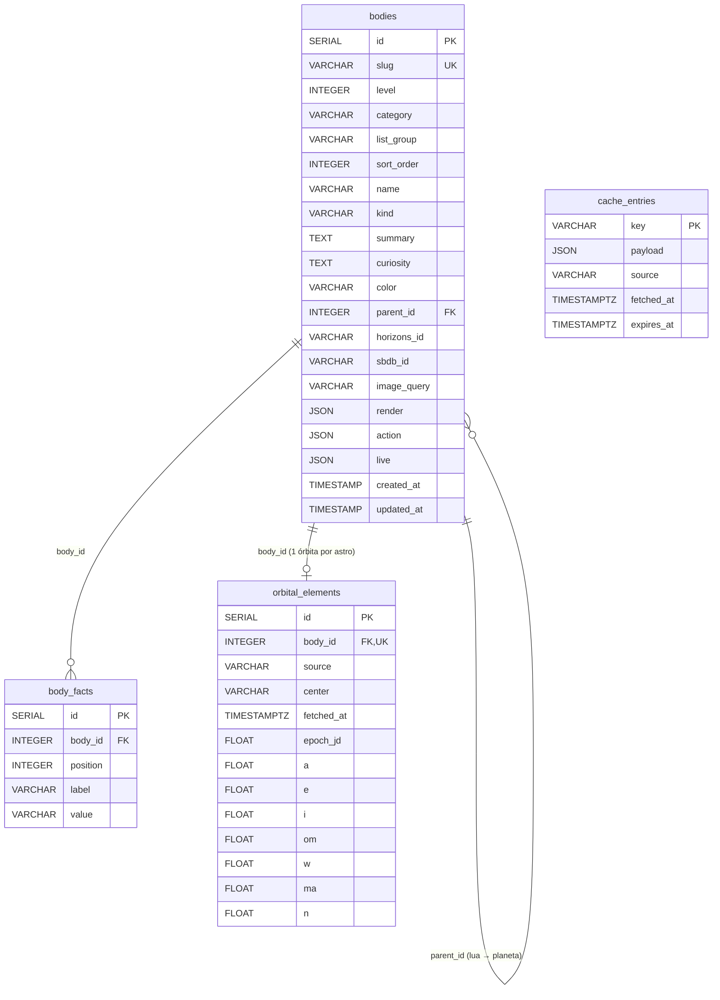

# Banco de dados físico — Atlas do Cosmos

Este documento traz o SQL do banco do Atlas do Cosmos, no **PostgreSQL** (Supabase).

O projeto não executa este arquivo. As tabelas são criadas pelo SQLAlchemy a partir dos
modelos Python (`atlas init-db` ou ao subir o servidor). O SQL abaixo foi gerado desses
modelos com o dialeto do PostgreSQL e é o mesmo que foi executado no Supabase. Se um modelo
mudar, gere este arquivo de novo (veja [Como regenerar](#como-regenerar)).

| Tabela | Modelo | O que guarda |
|---|---|---|
| `bodies` | [`atlas/catalog/models.py`](../atlas/catalog/models.py) — `Body` | Os astros do catálogo (textos didáticos, IDs na NASA, hierarquia lua → planeta) |
| `body_facts` | [`atlas/catalog/models.py`](../atlas/catalog/models.py) — `BodyFact` | As linhas da tabela de dados de cada card |
| `orbital_elements` | [`atlas/orbits/models.py`](../atlas/orbits/models.py) — `OrbitalElements` | A órbita de cada astro, vinda do JPL |
| `cache_entries` | [`atlas/ext/cache/models.py`](../atlas/ext/cache/models.py) — `CacheEntry` | As respostas da NASA já processadas, com validade |

## Diagrama



`cache_entries` não se liga às outras tabelas: a chave é um texto como `apod:2026-10-30`.

## Script completo

As tabelas estão na ordem de criação: `bodies` vem antes das tabelas que apontam para ela.

```sql
-- =====================================================================
-- bodies: astros do catálogo (carregados de atlas/catalog/data/catalog.json)
-- =====================================================================
CREATE TABLE bodies (
    id          SERIAL       NOT NULL,
    slug        VARCHAR(60)  NOT NULL,           -- identificador na URL, ex.: 'marte'
    level       INTEGER      NOT NULL,           -- 1 = Sistema Solar, 2 = Via Láctea, 3 = Universo
    category    VARCHAR(20)  NOT NULL,           -- star, planet, moon, dwarf, comet, probe, galaxy...
    list_group  VARCHAR(60)  NOT NULL,           -- grupo na lista lateral, ex.: 'Planetas'
    sort_order  INTEGER      NOT NULL,
    name        VARCHAR(120) NOT NULL,
    kind        VARCHAR(160) NOT NULL,
    summary     TEXT         NOT NULL,           -- texto didático do card
    curiosity   TEXT,
    color       VARCHAR(9),                      -- cor em hexadecimal, ex.: '#ff8a6a'
    parent_id   INTEGER,                         -- lua -> planeta
    horizons_id VARCHAR(20),                     -- COMMAND do JPL Horizons, ex.: '499' (Marte)
    sbdb_id     VARCHAR(40),                     -- busca no JPL Small-Body Database, ex.: 'Ceres'
    image_query VARCHAR(120),                    -- busca na NASA Image and Video Library
    render      JSON         NOT NULL,           -- parâmetros do motor 3D (raio, textura...)
    action      JSON,                            -- botão do card, ex.: {"label": ..., "level": 2}
    live        JSON         NOT NULL,           -- painéis ao vivo: "flares", "epic", "neos"...
    created_at  TIMESTAMP WITHOUT TIME ZONE DEFAULT now() NOT NULL,
    updated_at  TIMESTAMP WITHOUT TIME ZONE DEFAULT now() NOT NULL,
    PRIMARY KEY (id),
    FOREIGN KEY (parent_id) REFERENCES bodies (id) ON DELETE SET NULL
);
CREATE INDEX        ix_bodies_level     ON bodies (level);
CREATE INDEX        ix_bodies_parent_id ON bodies (parent_id);
CREATE UNIQUE INDEX ix_bodies_slug      ON bodies (slug);

-- =====================================================================
-- cache_entries: respostas da NASA guardadas (ver atlas/ext/cache)
-- =====================================================================
CREATE TABLE cache_entries (
    key        VARCHAR(200) NOT NULL,            -- ex.: 'apod:2026-10-30', 'neo:week:...'
    payload    JSON         NOT NULL,            -- resposta já processada
    source     VARCHAR(60)  NOT NULL,            -- API de origem, ex.: 'NASA APOD'
    fetched_at TIMESTAMP WITH TIME ZONE NOT NULL,
    expires_at TIMESTAMP WITH TIME ZONE NOT NULL, -- depois disso, consulta a NASA de novo
    PRIMARY KEY (key)
);

-- =====================================================================
-- body_facts: linhas da tabela de dados de cada card
-- =====================================================================
CREATE TABLE body_facts (
    id       SERIAL       NOT NULL,
    body_id  INTEGER      NOT NULL,
    position INTEGER      NOT NULL,              -- ordem da linha na tabela do card
    label    VARCHAR(120) NOT NULL,              -- ex.: 'Diâmetro'
    value    VARCHAR(255) NOT NULL,              -- ex.: '6.779 km'
    PRIMARY KEY (id),
    CONSTRAINT uq_body_fact_position UNIQUE (body_id, position),
    FOREIGN KEY (body_id) REFERENCES bodies (id) ON DELETE CASCADE
);
CREATE INDEX ix_body_facts_body_id ON body_facts (body_id);

-- =====================================================================
-- orbital_elements: elementos orbitais de um astro numa época (JPL)
-- Com eles o frontend calcula a posição em qualquer data (equação de Kepler).
-- =====================================================================
CREATE TABLE orbital_elements (
    id         SERIAL      NOT NULL,
    body_id    INTEGER     NOT NULL,
    source     VARCHAR(40) NOT NULL,             -- 'JPL Horizons' ou 'JPL SBDB'
    center     VARCHAR(30) NOT NULL,             -- centro de referência, ex.: '500@10' = Sol
    fetched_at TIMESTAMP WITH TIME ZONE NOT NULL,
    epoch_jd   FLOAT       NOT NULL,             -- época (data juliana)
    a          FLOAT       NOT NULL,             -- semieixo maior (UA)
    e          FLOAT       NOT NULL,             -- excentricidade
    i          FLOAT       NOT NULL,             -- inclinação (°)
    om         FLOAT       NOT NULL,             -- longitude do nó ascendente Ω (°)
    w          FLOAT       NOT NULL,             -- argumento do periélio ω (°)
    ma         FLOAT       NOT NULL,             -- anomalia média na época (°)
    n          FLOAT       NOT NULL,             -- movimento médio (°/dia)
    PRIMARY KEY (id),
    FOREIGN KEY (body_id) REFERENCES bodies (id) ON DELETE CASCADE
);
CREATE UNIQUE INDEX ix_orbital_elements_body_id ON orbital_elements (body_id);

-- =====================================================================
-- Segurança no Supabase: RLS ligado e sem policies.
-- A API REST pública (anon key) não lê nem altera nada; o backend conecta
-- como dono das tabelas e não é afetado. Ver Database.create_all.
-- =====================================================================
ALTER TABLE bodies           ENABLE ROW LEVEL SECURITY;
ALTER TABLE cache_entries    ENABLE ROW LEVEL SECURITY;
ALTER TABLE body_facts       ENABLE ROW LEVEL SECURITY;
ALTER TABLE orbital_elements ENABLE ROW LEVEL SECURITY;
```

## Regras de integridade

| Regra | Onde | Efeito |
|---|---|---|
| `slug` único | `ix_bodies_slug` | Dois astros não podem ter o mesmo identificador |
| Lua → planeta | `bodies.parent_id` `ON DELETE SET NULL` | Apagar um planeta não apaga as luas; elas ficam sem "pai" |
| Dados do card | `body_facts.body_id` `ON DELETE CASCADE` | Apagar um astro apaga as linhas da tabela dele |
| Uma linha por posição | `uq_body_fact_position` | O mesmo card não tem duas linhas na mesma posição |
| Uma órbita por astro | `ix_orbital_elements_body_id` (único) | Relação 1:1 entre `bodies` e `orbital_elements` |
| Órbita do astro | `orbital_elements.body_id` `ON DELETE CASCADE` | Apagar um astro apaga a órbita dele |

As datas de `cache_entries` e `orbital_elements` têm fuso horário (sempre em UTC). As de
`bodies` não têm e são preenchidas pelo próprio banco (`now()`).

## Consultas úteis

No Supabase, rode estas consultas em **SQL Editor**. No terminal, use `atlas shell`.

```sql
-- Planetas e quantas luas cada um tem
SELECT p.name, count(l.id) AS luas
FROM bodies p
LEFT JOIN bodies l ON l.parent_id = p.id
WHERE p.category = 'planet'
GROUP BY p.name
ORDER BY luas DESC;

-- Órbitas salvas e de onde vieram
SELECT b.name, o.source, o.a AS semieixo_ua, o.e AS excentricidade, o.fetched_at
FROM orbital_elements o
JOIN bodies b ON b.id = o.body_id
ORDER BY o.a;

-- Estado do cache da NASA
SELECT key, source, fetched_at, expires_at, expires_at < now() AS vencido
FROM cache_entries
ORDER BY fetched_at DESC;

-- Conferir se o RLS está ligado
SELECT relname, relrowsecurity
FROM pg_class
WHERE relname IN ('bodies', 'body_facts', 'cache_entries', 'orbital_elements');
```

## Como regenerar

Depois de mudar um modelo, gere o SQL de novo com o ambiente virtual ativado:

```powershell
python -c "from sqlalchemy.schema import CreateTable, CreateIndex; from sqlalchemy.dialects import postgresql; from atlas.ext.db import Base, register_models; register_models(); d = postgresql.dialect(); [print(str(CreateTable(t).compile(dialect=d)).strip() + ';', *[str(CreateIndex(i).compile(dialect=d)).strip() + ';' for i in t.indexes], sep='\n') for t in Base.metadata.sorted_tables]"
```

Lembre-se de que `create_all` só cria tabelas que ainda não existem. Para aplicar uma mudança
de coluna no Supabase, rode `atlas init-db --reset`.
